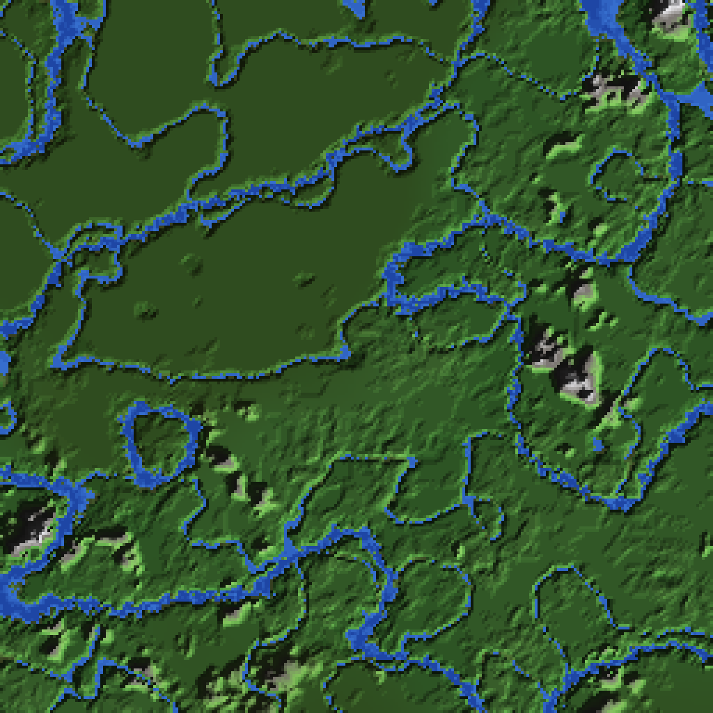

# Flatlands — 현실 같으면서 건축하기 좋은 평지 세계

마인크래프트 **1.21 ~ 1.21.1** (NeoForge/Fabric/바닐라) 데이터 팩입니다. 새 월드를 만들 때 월드 유형에서 고르면,

- 땅의 대부분은 **y≈64~69의 잔잔한 평지**(출렁임 표준편차 약 0.9블록)이고,
- 그중 약 30%는 **거의 완전한 평탄 구역**(표준편차 약 0.1블록)이라 큰 건물을 바로 지을 수 있고,
- **본류와 지류가 이어지는 강망**이 땅을 가르며, 강 양쪽에는 **평평한 하안단구**·**모래/자갈 강변**·**강변 숲**이 있고,
- 군데군데 **돌산이 삐죽 솟아** 있는 모습이 나옵니다.

**동굴과 용암호수는 없습니다.** 지하는 단단한 암반이고 광물만 바닐라처럼 들어 있습니다. 바다와 큰 언덕도 없습니다.



> 위 그림은 게임 화면이 아니라, 이 데이터 팩의 밀도 함수를 파이썬으로 평가해 그린 **시뮬레이션**입니다(`tools/simulate.py`). 파랑=물, 연한 초록=강둑, 약간 노란 매끈한 면=평탄 구역, 회색·흰색=돌산(높이 72 이상·100 이상). 실제 게임의 모양은 시드마다 다르지만 통계는 비슷해야 합니다.

## 파일

| 용도 | 데이터 팩 | 리소스 팩(이름 표시, 선택) |
|---|---|---|
| 일반 (바닐라·Create 등) | [`flatlands-datapack-1.21-1.21.1.zip`](dist/flatlands-datapack-1.21-1.21.1.zip) | [`flatlands-names-resourcepack-1.21-1.21.1.zip`](dist/flatlands-names-resourcepack-1.21-1.21.1.zip) |
| Biomes O' Plenty (NeoForge 1.21.1) | [`flatlands-datapack-1.21.1-BiomesOPlenty.zip`](dist/flatlands-datapack-1.21.1-BiomesOPlenty.zip) | 위와 같은 리소스 팩 |

데이터 팩 포맷 48(리소스 34)입니다. 일반 팩과 BoP 팩은 **동시에 켜지 마세요**(같은 ID를 공유합니다). 26.3용은 더 이상 관리하지 않습니다(git 기록 `d83c86a` 이전 참고).

## 월드 유형

| 월드 유형 | 내용 |
|---|---|
| **Flatlands (Plains & Rivers)** — 기본 | 평원·강 위주. 아주 춥거나 더운 곳, 아주 습한 곳에서만 눈 덮인 평원·사막·숲이 조금 나옵니다. 돌산에는 돌산 바이옴(눈 덮인 쪽은 `frozen_peaks`, 산기슭은 `windswept_hills`)이 붙고, 강변은 모래·자갈, 그 바깥은 숲 띠입니다. |
| **Flatlands (Plains & Rivers only)** | 지표 바이옴이 **평원 / 해바라기 평원 / 강**에 모래 강변과 돌산(`stony_peaks`)만 더해집니다. 강변 숲은 없습니다. |
| **Flatlands (… + Biomes O' Plenty)** | BoP 팩 전용. 아래 "Biomes O' Plenty" 절 참고. |

## 시뮬레이션 추정치

여러 시드(12345·555·777·999)의 2048×2048블록 창과 40960×40960블록 표본으로 평가했습니다. 평탄 구역과 돌산은 한 덩어리가 1~2km라서 작은 창에서는 시드에 따라 폭이 큽니다.

| 평지 출렁임 (강 근처·산 제외) | 전체 표준편차 | 64블록 안의 국소 표준편차 | 5~95% 높이 |
|---|---|---|---|
| 일반 구역 | 0.89 ~ 0.94 | 0.56 ~ 0.62 | y 65 ~ 68 |
| **평탄 구역** | **0.11 ~ 0.14** | 0.08 ~ 0.11 | y 66 한 줄 |

| 강 | 값 |
|---|---|
| 본류 | 폭(가로 단면 중앙값) 약 **24블록**, 90%는 56~64 이하, 물 깊이 평균 약 4.8 (바닥 y≈58) |
| 지류 | 폭 약 **8블록**, 90%는 24~32 이하, 물 깊이 평균 약 2.6 (바닥 y≈60) |
| 하안단구 | 강 양쪽에 y≈64의 평평한 선반 약 10블록. 그 구간 육지의 74~81%가 y 63.5~65.5 |
| 물이 있는 면적 / river 바이옴 면적 | 약 9~11% / 약 14~16% (물은 100% river 바이옴 안) |
| 강변 모래·자갈 띠 | 약 4% |

| 바이옴 면적 | 기본 | 평원·강만 | BoP |
|---|---|---|---|
| 평원 계열 + 강 | 약 71% | 약 91% | 약 75% (BoP 평원류 포함) |
| 돌산·산기슭 | 약 5~6% | 약 5% | 약 5% |

| 돌산 (평지보다 솟은 정도) | 값 |
|---|---|
| 3블록 이상 솟은 면적 | 약 2.5 ~ 7% |
| 30블록 이상 솟은 면적 | 약 0.5 ~ 3% |
| 가장 높은 지표 | 시드에 따라 y 124 ~ 136 |
| 산 위 경사 | 중앙값 약 0.4(≈22°), 90%는 1.1~1.4(≈48~55°) |

## 동굴·용암호수 제거

- **밀도 함수**: `final_density`에서 치즈·스파게티·입구·기둥 동굴을 전부 걷어내고 가는 터널(noodle)도 끕니다. 지하는 동굴 없이 단단합니다.
- **카버**: `minecraft:cave`, `cave_extra_underground`, `canyon`의 확률을 0으로 덮어써서 지표를 가르는 동굴·협곡도 없앱니다.
- **용암호수**: `lake_lava_surface`, `lake_lava_underground` 배치 개수를 0으로 덮어씁니다.
- 이 덮어쓰기는 **이 팩을 켠 월드의 오버월드 전체**에 적용됩니다(다른 모드의 바이옴도 같은 카버·피처를 쓰면 함께 꺼집니다). 동굴 바이옴(무성한 동굴·점적석 동굴)도 생기지 않습니다.
- 남는 것: 광물은 바닐라 높이 분포 그대로라 **스트립 마이닝**으로 찾아야 합니다. 폐광(mineshaft)·던전·지오드·요새 같은 구조물은 바닐라 그대로라 지하에 작은 공간은 생길 수 있습니다. 작은 용암 샘(`spring_lava`)은 남겨 두었지만 공기와 맞닿아야 생기므로 동굴이 없는 지금은 거의 만나지 못할 것으로 보입니다(확인하지는 못함).

## Biomes O' Plenty (NeoForge 1.21.1)

BoP를 쓰신다면 일반 팩 대신 BoP 팩을 쓰세요. 월드 유형 이름은 **Flatlands (Plains & Rivers + Biomes O' Plenty)** 입니다.

- **BoP 평원 계열만 섞입니다.** `field`(꽃밭), `grassland`(초원), `prairie`(프레리), `pasture`(목초지), `lavender_field`(라벤더 밭), `shrubland`(관목지)를 온도·습도 구간별로 배치합니다. 강변 숲 띠는 BoP의 `marsh`(갈대 습지, 건조할 때)와 `wetland`(습지 숲, 촉촉할 때)입니다. BoP의 산·정글·화산 같은 바이옴은 일부러 뺐고, 돌산은 바닐라 바이옴을 씁니다.
- **TerraBlender의 overworld 지역 주입을 이 팩이 끕니다.** BoP는 TerraBlender로 자기 바이옴 지역을 끼워 넣는데, 그 지역은 바닐라 배치 규칙을 변형한 것이라 이 팩의 평탄한 지형·강 위치와 맞지 않아 산 바이옴이 평지에 뜰 수 있습니다. 그래서 `terrablender:overworld_regions` 태그를 비워(`replace: true`) 이 월드에서는 지역 주입을 끄고, 고른 BoP 바이옴만 목록에 직접 넣었습니다.
- **BoP가 반드시 설치되어 있어야 합니다.** 없이 켜면 바이옴 참조 오류로 데이터 팩이 로딩되지 않습니다.
- **확인하지 못한 것**: BoP 21.1.0.14와 TerraBlender 4.1.0.8의 jar를 풀어 읽고 판단했을 뿐 실행해 보지는 못했습니다. 태그를 비우면 주입이 꺼진다는 것은 클래스 문자열로 추정한 것이고, BoP의 지표 블록 규칙(일부 바이옴의 잔디·흙 변형)은 TerraBlender가 주입하므로 이 팩에서는 적용되지 않습니다.
- **Create와 애드온**: Create 6.0.10은 `#minecraft:is_overworld`에 광석 피처만 더하고 바이옴·노이즈 설정은 건드리지 않아 충돌하지 않습니다(jar를 읽어 확인). 애드온은 전부 확인하지 못했습니다.

## 설치

1. 위 표에서 알맞은 데이터 팩 zip을 받습니다. (압축을 풀지 않습니다.)
2. **새 월드 만들기** 화면에서 데이터 팩 화면을 열어 zip을 추가하고 활성화합니다. (월드 만들기 → 더보기 탭 → 데이터 팩)
3. 월드 유형에서 Flatlands를 **직접 고릅니다.** (기본 월드 유형은 바뀌지 않습니다.)

월드 유형 이름이 `generator.flatlands.flatlands` 처럼 키 그대로 보이면 리소스 팩 zip을 켜 주세요. 이름만 바뀝니다.

### 주의

- **새 월드 전용**입니다. 기존 월드의 `datapacks` 폴더에 넣거나 `/datapack enable`로 켜도 아무것도 바뀌지 않고, 청크 경계에서 지형이 끊깁니다.
- 서버에서는 월드를 처음 만들기 전에 zip을 `world/datapacks/`에 넣고 `server.properties`에 `level-type=flatlands:flatlands`(BoP는 `flatlands:bop`)와 `initial-enabled-packs=vanilla,file/<zip 파일 이름>`을 지정하는 방식일 것입니다. 직접 해 보지는 못했습니다.
- 바다와 해변이 없으므로 해저 신전·난파선 같은 바다 구조물은 생기지 않습니다.
- 4블록 간격의 지형 보간이 시뮬레이션에 반영되지 않아서, 실제 봉우리는 그림보다 조금 둥글 수 있습니다.

## 어떻게 동작하나

바닐라 지형은 `offset`(기본 높이) · `factor`(경사) · `jaggedness`(봉우리 모서리) 세 함수로 산과 바다를 만듭니다. 이 팩은 **그 함수들을 자기 것으로 바꾸고**, 나머지(지표 블록 규칙, 대수층, 광물, 몹)는 바닐라를 그대로 씁니다. 1.21에서는 노이즈 라우터와 지표 규칙이 `noise_settings` 안에 인라인이라, 바닐라 설정을 복사해 `depth`/`factor`/`sloped_cheese`/`ridges`/`continents` 참조만 바꾸고 `final_density`에서 동굴을 걷어냅니다.

```
flat_zone(평탄 구역 0~1) ─▶ relief(= 1 - 0.8·zone) ──┬─▶ land_height(±1.9블록 기복)
                                                    ├─▶ 3D 노이즈 세기(× 0.30)
                                                    └─▶ (1 - zone) 을 산 높이에 곱함

river_main_abs ───▶ river_main_profile(본류 단면: 강바닥→물가→단구→강둑) ─┐
river_branch_abs ─▶ river_branch_profile(지류 단면: 얕고 좁음) ───────────┼▶ min(육지, 본류, 지류) + 산 높이
land_height ─────────────────────────────────────────────────────────────┘    = surface_height ▶ offset ▶ depth
                                                                                ▶ sloped_cheese ▶ final_density(동굴 제거)
min(본류|N|/기준, 지류|N|/기준) ▶ river_distance D ─▶ router.ridges(바이옴): D<0.40 강 / 0.40~0.52 모래·자갈 / 0.52~1.05 강변 숲
mountain_noise ▶ mountain_rise(D<0.8 과 평탄 구역에서는 0) ▶ mountain_height ─▶ router.continents(돌산 바이옴), rock_mask(산 위 거칠기)
```

- **출렁임**: 완만한 기복(바닐라 `erosion` 노이즈 복사본, ±1.9블록)과 잔 요철(바닐라 3D 노이즈의 0.30배)을 합쳐 일반 구역 표준편차가 약 0.9블록입니다. 평탄 구역에서는 둘 다 80% 줄어 약 0.1블록입니다.
- **평탄 구역**: 독립 시드의 저주파 노이즈(`temperature` 노이즈 복사본, 한 구역 1~2km)가 문턱을 넘는 곳입니다. 산도 여기서는 서지 않습니다. 구역 경계는 부드럽게 이어져 땅이 갑자기 끊기지 않습니다.
- **강의 위계**: 큰 규모의 **본류**(노이즈 배율 0.14)와 작은 규모의 **지류**(0.30)를 따로 두고 각자의 단면을 적용합니다. 노이즈의 0 등고선은 끊기지 않고 이어지는 곡선이라 강이 길게 이어지고 강망이 됩니다. 같은 중심선에서 지형과 바이옴(`river_distance`)이 함께 나오므로 **물이 있는 곳과 `river` 바이옴이 어긋나지 않습니다.**
- **하안단구**: 강 단면이 `min(육지, 강 단면)`이라, 물가(y 62.5)에서 y≈64의 평평한 선반으로 올라섰다가 완만한 강둑으로 육지에 닿습니다. 선반 위가 곧 강변 모래 띠이고, 그 바깥이 강변 숲입니다.
- **돌산**: 별도 노이즈가 문턱(0.40)을 넘는 곳만 가파르게 솟고, 산 위에서는 3D 노이즈 비율을 키워 거칠게 합니다. 바이옴은 산 높이 신호(0~1 = 0~40블록)로 고릅니다.
- **바이옴 축**: 강 거리 → `weirdness`, 산 높이 신호 → `continentalness`, 온도·습도·침식은 바닐라 함수 그대로입니다(`erosion`은 해바라기 평원과 강변 숲/자갈 구분에도 씁니다).

## 튜닝

모든 값은 [`tools/generate.py`](tools/generate.py) 위쪽의 `PARAMS`와 단면 표(`RIVER_MAIN`, `RIVER_BRANCH`, `MOUNTAIN_PROFILE`)에 있습니다. 바꾼 뒤 아래 "도구"의 순서대로 다시 생성하면 됩니다.

| 값 | 기본 | 효과 |
|---|---|---|
| `land_amp` | 1.9 | 완만한 기복의 크기(블록). 키우면 일반 구역 출렁임이 커짐 |
| `micro_k` | 0.30 | 잔 요철의 세기. 0 = 완전 평탄, 1 = 바닐라 평원. 일반 구역 출렁임의 나머지 절반 |
| `land_base` | 66.5 | 육지의 평균 높이 |
| `flat_lo` / `flat_hi` | 0.10 / 0.25 | 평탄 구역 문턱. 낮추면 평탄 구역이 늘어남(지금 약 30%) |
| `flat_scale` | 0.5 | 평탄 구역 크기. 작을수록 한 구역이 큼 |
| `flat_residual` | 0.2 | 평탄 구역에 남기는 기복 비율. 0이면 완전 평지 |
| `river_main_scale` / `river_branch_scale` | 0.14 / 0.30 | 본류/지류의 규모. 작을수록 길고 크게 굽이침 |
| `river_main_w` / `river_branch_w` | 0.60 / 0.55 | 본류/지류 폭 배율(단면과 바이옴 폭에 함께 곱함). 키우면 넓어짐 |
| `RIVER_MAIN` / `RIVER_BRANCH` | — | (거리, 땅 높이) 단면. 강바닥 깊이·단구 높이와 폭을 직접 고침 |
| `mountain_scale` | 1.0 | 산 노이즈 규모. 작을수록 산이 넓고 드묾 |
| `MOUNTAIN_PROFILE` | 문턱 0.40 | (노이즈 값, 솟는 높이). 문턱을 올리면 산이 줄고, 높이를 키우면 더 높아짐 |
| `rock_extra` | 0.8 | 산 위의 거칠기. 키우면 더 삐죽하고 울퉁불퉁 |
| `T_COLD` `T_HOT` `H_WET` | −0.55 / 0.65 / 0.35 | 눈 평원·사막·숲이 나오는 기후 경계. 극단으로 밀수록 평원이 늘어남 |
| `E_RIPARIAN` | 0.15 | 강변 숲이 서는 침식 값. 올리면 강변 숲이 줄어듦 |

## 무엇을 확인했고, 무엇을 확인하지 못했나

**확인한 것**

- `tools/validate.py` — 팩이 가리키는 모든 밀도 함수·노이즈·바이옴·노이즈 설정·월드 프리셋이 1.21.1 바닐라 데이터(와 BoP 데이터)와 이 팩 안에 실제로 존재하는지, 참조에 순환이 없는지, 바이옴 파라미터 형식이 맞는지, `final_density`에 동굴 항이 없는지, 카버 확률이 0이고 용암호수 개수가 0인지.
- 1.21.1 서버 jar에서 푼 바닐라 파일에 실제로 쓰이는 문법(`argument1/2`, `flat_cache`, `shifted_noise`, `y_clamped_gradient`, 노이즈 `firstOctave/amplitudes`, 인라인 `spawn_target`, `configured_carver`/`placed_feature` 구조)과 같은 형태인지 대조했습니다. 1.21(.0)은 jar를 따로 받아 보지 않았고 1.21.1과 같은 데이터 팩 포맷(48)이라는 점에 기댔습니다.
- `tools/simulate.py` — 이 팩의 JSON 밀도 함수를 그대로 평가해서 높이·출렁임·기울기·강 폭과 깊이·물 면적·바이옴 비율을 추정했습니다(시드 여러 개, 세 월드 유형).

**확인하지 못한 것**

- **실제 게임/서버에서 월드를 생성해 보지 못했습니다.** 이 작업 환경에서는 서버를 실행할 수 없었습니다. 따라서 "게임이 이 팩을 오류 없이 불러오는지", "카버·용암호수 덮어쓰기가 의도대로 먹히는지"는 직접 확인해 보셔야 합니다. 문제가 생기면 `logs/latest.log`의 오류 줄을 알려 주세요.
- 시뮬레이터는 근사입니다. 알려진 노이즈 알고리즘을 옮긴 것이지만 시드가 다르고, 4×8×4 셀 보간·구조물·`beardifier`는 무시합니다. 수치는 "대략 이 정도"로 보세요.

## 폴더 구조와 도구

```
flatlands/
├─ datapack-1.21/       ← 1.21~1.21.1 데이터 팩 (tools/generate.py 가 만든 결과물을 커밋해 둠)
├─ datapack-1.21-bop/   ← 1.21.1 + Biomes O' Plenty 데이터 팩
├─ resourcepack-1.21/   ← 월드 유형 이름만 넣는 선택 리소스 팩
├─ dist/                ← 바로 쓸 수 있는 zip (tools/make_zip.py 결과)
├─ docs/                ← README 그림
└─ tools/
   ├─ generate.py       ← 튜닝 값 → 데이터 팩 JSON 생성 (--target 1.21 | 1.21-bop, 바닐라 데이터 필요)
   ├─ validate.py       ← 정적 검증
   ├─ simulate.py       ← 지형·바이옴 시뮬레이션 (numpy, PIL)
   └─ make_zip.py       ← zip 만들기
```

생성기·검증기·시뮬레이터는 1.21.1 바닐라 데이터가 필요합니다. 서버 jar를 풀면 `META-INF/versions/1.21.1/server-1.21.1.jar`가 나오고, 그 안의 `data/`를 풀어 둔 폴더를 `--vanilla`로 넘깁니다. BoP 팩의 검증에는 풀어 둔 BoP jar 폴더를 `--mod-data`로 넘깁니다.

```bash
# 바닐라 데이터 풀기 (한 번만)
mkdir vanilla && cd vanilla && unzip -q ../server-1.21.1.jar 'data/minecraft/worldgen/*' 'data/minecraft/tags/worldgen/*' && cd ..

python3 tools/generate.py --target 1.21 --vanilla vanilla   # datapack-1.21/ 다시 생성
python3 tools/validate.py --target 1.21 --vanilla vanilla   # 참조·형식 검증
python3 -I tools/simulate.py --target 1.21 --vanilla vanilla --png /tmp/map.png   # 지형 시뮬레이션 + 지도 그림 (몇 분 걸림)
python3 tools/make_zip.py                                   # dist/ 갱신
```
